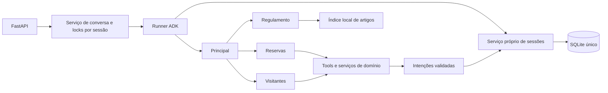

# Assistente do Residencial Aurora

API Python com Google ADK 2.12.0 e Gemini para reservas, visitantes e dúvidas sobre o regulamento. Implementa o [PRD](docs/PRD.md), o [FDD](docs/FDD.md) e as [ADRs aceitas](docs/adrs/generated/indice.md).

## Arquitetura

[Configuração da equipe](src/aurora/agents/team.py): o principal transfere atendimento para três especialistas. Reservas recebe tools de agenda, reserva e cancelamento; visitantes recebe consulta e autorização; regulamento recebe apenas busca seletiva. Essa divisão limita o conjunto de tools por domínio e permite retomar o especialista que pediu confirmação. Os quatro usam a mesma configuração Gemini.



As tools mutáveis preparam intenções sem gravar efeitos. O [adaptador de sessão](src/aurora/storage/sessions.py), no ponto `append_event` do Runner, aplica cada grupo de intenções e persiste seus resultados antes de liberar a próxima inferência. A chamada Gemini fica fora da transação. Em lotes, os efeitos são aplicados sequencialmente na mesma conexão. A restrição SQL decide a disponibilidade no instante da escrita.

O ADK 2.12.0 pode emitir `adk_request_confirmation` antes ou depois da resposta provisória da tool, conforme o lote. O adaptador agrupa esses eventos e só confirma a proposta quando possui ambos. Na retomada, a resposta externa também aguarda o evento da tool original: efeito, resultado, conclusão, estado, eventos e checkpoint usam o mesmo `BEGIN IMMEDIATE`/commit. O histórico completo e os eventos de estado do ADK permitem ao Runner reconstruir a execução após reinício.

O banco usa chaves estrangeiras, sincronização `FULL`, journal padrão de rollback e índice único parcial para reservas ativas. Operações SQLite rodam em callbacks síncronos em threads; cada callback abre e fecha sua conexão no mesmo thread. A versão do esquema é verificada na inicialização. Um catálogo parcialmente populado ou incompatível impede a subida; bancos válidos são preservados.

## Garantias

| Garantia | Código responsável e mecanismo |
| --- | --- |
| Cobrança/acesso somente com confirmação | [DomainService.stage](src/aurora/services/domain.py#L46) determina a taxa e prepara a proposta; [ChatService.confirm](src/aurora/services/chat.py#L80) valida a pendência da sessão e constrói a resposta ADK; [apply](src/aurora/storage/actions.py#L22) exige vínculo persistido, argumentos originais e autorização da rota. Texto ou argumentos escolhidos pelo modelo não substituem essa autorização |
| Isolamento por apartamento | [DomainService.scoped](src/aurora/services/domain.py#L30) e [apply](src/aurora/storage/actions.py#L11) obtêm o apartamento da coluna persistida da sessão; [nenhuma tool aceita apartamento](src/aurora/tools/domain.py#L6). [Cancelamento](src/aurora/storage/actions.py#L46) filtra apartamento e código; [disponibilidade](src/aurora/services/domain.py#L37) projeta apenas booleano. O modelo não escolhe o escopo nem recebe dados da reserva alheia |
| Persistência e retomada | [SQLiteSessionService.append_event](src/aurora/storage/sessions.py#L60) persiste eventos ADK completos e estado, preservando invocação e especialista; [get_session](src/aurora/storage/sessions.py#L35) reconstrói a sessão do banco; [Database.write](src/aurora/storage/database.py#L73) controla a transação única. A continuidade depende dos dados persistidos, e deltas do modelo não alteram a identidade |
| Regulamento seletivo | [RegulationSearch](src/aurora/regulation/search.py#L39) indexa capítulos/artigos em memória; [buscar_regulamento](src/aurora/regulation/search.py#L52) retorna somente artigos pertinentes e pede esclarecimento em caso de ambiguidade. A seleção ocorre no código da busca; [o principal](src/aurora/agents/team.py#L51) não recebe o texto do regulamento nas instruções |
| Uma reserva por área/data | [Índice único `uq_reserva_ativa`](src/aurora/storage/database.py#L23) impõe exclusividade na gravação, independentemente de consultas prévias ou decisões do modelo; [apply](src/aurora/storage/actions.py#L31) transforma colisão de agenda em recusa de negócio. A [chave primária do código](src/aurora/storage/database.py#L20) e o [cancelamento sem excluir a linha](src/aurora/storage/actions.py#L46) impedem reutilizar códigos |

[Modelo/SDK](src/aurora/agents/model.py) limita o transporte a uma tentativa e cada inferência ao timeout configurado. [ChatService](src/aurora/services/chat.py) serializa mensagens/confirmações da mesma sessão; sessões distintas avançam em paralelo. Locks são liberados em erro e cancelamento. Cancelamento de uma escrita aguarda a thread concluir antes de liberar a sessão.

## Como rodar

Requisitos: uv e Python 3.13+ (versão exigida pelos metadados atuais; validado em 3.13.5). O banco é SQLite local; nenhum container é necessário.

```sh
cp .env.example .env
# Preencha GOOGLE_API_KEY no .env com sua chave do Google AI Studio.
uv sync --locked
uv run aurora probe
uv run aurora reset
uv run aurora serve
```

A API atende em `http://localhost:8000`. `probe` faz uma inferência real no modelo configurado. O servidor usa um processo/worker. Para encerrar, use Ctrl+C; suba novamente com `uv run aurora serve` para continuar as mesmas sessões.

**Execute `reset` com a API parada.** Ele restaura apartamentos, áreas, reservas e visitantes, e apaga todas as sessões, eventos, confirmações e execuções, em uma transação. Falha antes do commit preserva o estado anterior. Os arquivos de `dados/` são somente fontes de leitura e nunca são escritos pela aplicação.

| Variável do `.env` | Padrão quando vazia ou ausente |
| --- | --- |
| `GOOGLE_API_KEY` | Obrigatória para servir/inferir; reset funciona sem chave |
| `GEMINI_MODEL` | `gemini-3.8-flash`, compartilhado pelos quatro agentes |
| `GEMINI_TIMEOUT_SECONDS` | `60`, por inferência |
| `SQLITE_BUSY_TIMEOUT_SECONDS` | `5`, espera pelo escritor |
| `AURORA_DB_PATH` | `var/aurora.sqlite3`, relativo à raiz do projeto |

Timeouts devem ser números finitos e positivos. O `.env` e os bancos locais são ignorados pelo Git. Não há retries automáticos nem troca automática de modelo; configurar `GEMINI_MODEL` é uma escolha explícita do operador.

### API

O contrato não usa prefixo `/v1`. Corpos e respostas são JSON. O OpenAPI está em `/openapi.json`.

| Método e rota | Corpo / resultado |
| --- | --- |
| `POST /sessoes` | `{"apartamento":"101"}` → `201 {"session_id":"..."}` |
| `POST /sessoes/{session_id}/mensagens` | `{"texto":"Reserve o salão de festas para 2030-04-20."}` |
| `POST /sessoes/{session_id}/confirmacoes` | `{"id":"...","confirmado":true}` |
| `GET /sessoes/{session_id}/eventos` | Lista completa e ordenada dos eventos ADK, incluindo tools |
| `GET /apartamentos/{numero}/reservas` | Reservas ativas: `codigo`, `area`, `data` |
| `GET /apartamentos/{numero}/visitantes` | Autorizações: `nome`, `data` |

Mensagens e confirmações retornam:

```json
{
  "resposta": "",
  "confirmacoes_pendentes": [
    {
      "id": "identificador-opaco",
      "acao": "reservar_area",
      "detalhes": {
        "area": "salao-de-festas",
        "data": "2030-04-20",
        "taxa_centavos": 15000
      }
    }
  ]
}
```

O texto pode ser vazio enquanto a execução está suspensa. `confirmacoes_pendentes` sempre lista todas as pendências atuais da sessão; aprovação usa `true`, negativa usa `false`, ambos booleanos JSON. O cliente envia somente o ID e a decisão; os argumentos da ação vêm do banco. Mensagens durante pendência recebem `200` com orientação e não iniciam outra execução.

Negar encerra somente aquela proposta. Pedir novamente a mesma reserva na mesma sessão gera uma nova confirmação com outro ID; o ID negado continua retornando `409` e não autoriza a nova proposta.

Exemplo sem credenciais:

```sh
curl -s http://localhost:8000/apartamentos/101/reservas
curl -s -X POST http://localhost:8000/sessoes \
  -H 'Content-Type: application/json' -d '{"apartamento":"101"}'
# Substitua SESSION_ID pelo identificador retornado.
curl -s -X POST http://localhost:8000/sessoes/SESSION_ID/mensagens \
  -H 'Content-Type: application/json' \
  -d '{"texto":"Reserve o salão de festas para 2030-04-20."}'
# Substitua CONFIRMACAO_ID pela pendência retornada.
curl -s -X POST http://localhost:8000/sessoes/SESSION_ID/confirmacoes \
  -H 'Content-Type: application/json' \
  -d '{"id":"CONFIRMACAO_ID","confirmado":true}'
```

Sessão/apartamento ausente retorna `404`; confirmação inexistente, alheia ou já respondida retorna `409`; corpo inválido retorna `422`. Falha de inferência sem resultado de ação persistido retorna `502`, timeout retorna `504`, e indisponibilidade do banco retorna `503`. Disputa normal por uma reserva retorna `200`, com recusa de negócio para quem perder. Falha de geração após commit retorna `200` com uma apresentação determinística dos resultados persistidos, sem nova inferência.

Para testar pelo VSCode com a extensão [REST Client](https://marketplace.visualstudio.com/items?itemName=humao.rest-client), abra [api.http](api.http). Ajuste as variáveis no topo e execute `criarSessao`, `enviarMensagem` e, quando houver pendência, `responderConfirmacao`. Os IDs são capturados das respostas automaticamente. O arquivo também inclui consultas de verificação, exemplos de mensagens e casos de erro esperados.

### Testes e evidências

```sh
uv sync --locked
uv run pytest -q
AURORA_RUN_LIVE=1 uv run pytest tests/test_live.py -q -s
uv run aurora probe

git diff --check
git diff --exit-code HEAD -- dados/
```

A suíte padrão usa inferência programada, com Runner, transferências, tools, API e SQLite reais. Também exercita o transporte HTTP real do SDK contra respostas controladas de erro e timeout. O teste Gemini é opt-in, consome cota e usa banco temporário, servidor HTTP e reinícios de processo; não restaura o banco de uso normal. Ele percorre os 15 passos e acrescenta retomadas de pendências de reservas e visitantes após reinício.

[Relatório de validação](docs/validacao.md) registra versões, resultados, falhas iniciais do TDD e a correspondência com os critérios do FDD. Não foi adicionado linter ou formatador.

### Operação e limites

Logs operacionais da aplicação são JSON, com `X-Request-ID`, spans locais, duração e resultado de transação/inferência. Correlacione uma resposta com as linhas de mesmo `request_id`. Não há exportador de tracing, dashboard ou backend de métricas. Conversas, prompts, respostas Gemini, nomes, apartamentos, chaves e parâmetros SQL não são registrados nos logs. Os eventos completos ficam no SQLite e na rota de eventos, conforme o contrato.

A entrega é local, sem autenticação real: o apartamento da criação representa o morador autenticado, e as rotas de verificação são públicas para o avaliador. O processo único faz parte do contrato operacional; múltiplos workers exigiriam outra coordenação de sessões. Pagamento, estorno, antecedência, datas passadas, horários e capacidade não são validações das operações. A busca do regulamento usa aliases e relevância lexical; perguntas ambíguas podem exigir esclarecimento.

Referências de integração: [confirmações ADK](https://adk.dev/tools-custom/confirmation/) e código da versão 2.12.0 instalada, conforme [ADR de sessões](docs/adrs/generated/SESSION/ADR-XXX-confirmacoes-persistidas-e-retomada-do-adk.md).
