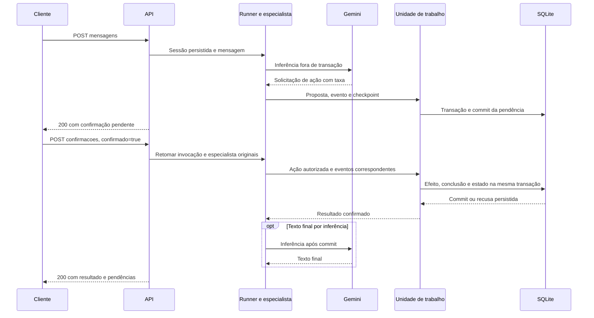
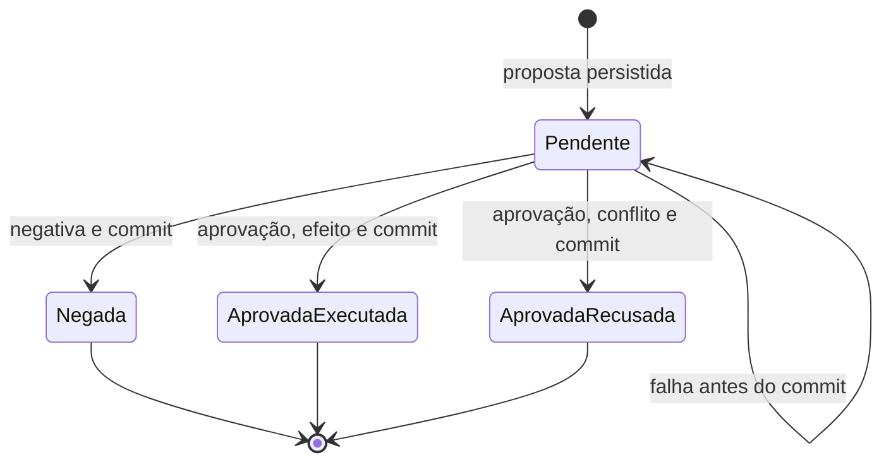

### FDD: Assistente do Residencial Aurora

Versão: 1.0
Data: 2026-10-15
Responsável: a definir

> Implementação e validação em 16/10/2026: consulte o [relatório de evidências](validacao.md) e o [README operacional](../README.md). As seções de desenho abaixo preservam as propostas originais; os critérios de aceite foram verificados na implementação entregue.

---

### 1. Contexto e motivação técnica

Implementar o assistente completo como uma API local, integrando atendimento com Google ADK, regras determinísticas nas tools e persistência transacional. O problema técnico é preservar autorização, isolamento, continuidade e exclusividade mesmo quando o modelo recebe instruções adversariais, a API reinicia ou duas sessões disputam uma reserva.

O contexto arquitetural é definido pelo [PRD](PRD.md), pelas [decisões aprovadas](decisoes.md) e pelas [sete ADRs](adrs/generated/indice.md). Não existe HLD separado usado como fonte deste documento. O contrato HTTP e os 15 passos de avaliação estão incorporados ao PRD, nas seções [Contrato HTTP](PRD.md#contrato-http) e [Fluxo do avaliador](PRD.md#fluxo-do-avaliador). Este FDD detalha a implementação futura; não declara código, acesso ao modelo ou testes concluídos.

**Atores e fronteiras**

- Morador: representado pelo apartamento validado na criação da sessão.
- Cliente HTTP e avaliador: enviam mensagens, respondem confirmações e consultam efeitos/eventos.
- Principal e especialistas de reservas, visitantes e regulamento: conduzem o atendimento; não definem permissões.
- Tools e serviços de aplicação: impõem escopo, confirmação e regras de escrita.
- Serviço de sessões próprio: adapta a persistência ao ADK e compartilha a unidade de trabalho das ações.
- SQLite: armazena domínio, sessões, eventos, confirmações e contexto de retomada em um arquivo.
- Gemini: dependência externa de inferência, fora das transações locais.

**Restrições e suposições**

- API em um único processo, com requisições de mensagem e confirmação serializadas por sessão. Sessões diferentes podem avançar em paralelo.
- Python 3.12+, uv, `google-adk==2.12.0`, FastAPI, Pydantic e acesso direto por `sqlite3`, sem ORM.
- Quatro agentes usando o modelo configurável `gemini-3.8-flash`; acesso e cota ainda precisam ser comprovados.
- Sem retries automáticos na aplicação ou no SDK, fallback automático de modelo ou reaplicação automática de tools.
- Uma transação curta por unidade de persistência; nunca manter transação de escrita durante inferência ou espera de aprovação.
- Os arquivos em `dados/` são imutáveis. Rotas de verificação não têm autenticação administrativa nesta entrega local.

As escolhas confirmadas nesta entrevista são requisitos deste FDD. Detalhes novos de estrutura de código, esquema, identificadores, busca e formato de erros são identificados como **propostas de implementação**, ainda sujeitos à validação. Assinaturas internas abaixo são contratos do projeto, não assinaturas presumidas do SDK.

---

### 2. Objetivos técnicos

| Objetivo | Medida ou invariante |
| --- | --- |
| Atender ao contrato do projeto | Todos os 15 passos do avaliador aprovados em execução real |
| Impedir autorização implícita | Zero reservas com taxa ou autorizações criadas antes de aprovação válida pela rota |
| Executar confirmação uma única vez | Uma aprovação executável produz um efeito; negativa e identificadores inválidos produzem zero |
| Preservar isolamento | Zero dados de terceiros nos resultados das tools, respostas ou eventos, inclusive sob prompt injection |
| Evitar dupla reserva | Duas aprovações concorrentes produzem exatamente uma reserva ativa e duas respostas `200` |
| Persistir atomicamente | Efeito, conclusão da confirmação, estado e eventos correspondentes confirmados ou revertidos juntos |
| Continuar após reinício | Eventos preservados, novas mensagens aceitas e confirmação pendente retomada no especialista original |
| Recuperar contexto pertinente | Resposta sobre piscina aos domingos fundamentada no artigo pertinente, sem capítulos de outros assuntos nos eventos |
| Tornar falhas verificáveis | Uma tentativa por inferência planejada; timeouts e rollback observáveis sem dados pessoais nos logs |
| Reproduzir o ambiente | Reset integral e atômico; zero alterações nos arquivos de origem |

Não há metas numéricas de latência, throughput ou SLA de produção. Durações serão medidas. Os timeouts da seção 6 são limites operacionais, não metas de desempenho.

---

### 3. Escopo e exclusões

**Incluído**

- Seis operações HTTP do contrato, schemas, erros e consultas diretas de verificação.
- Principal e três especialistas por transferência no ADK, com tools por domínio.
- Esquema SQLite, carga inicial, restrições de integridade, histórico e unidade de trabalho.
- Serviço de sessões próprio, eventos completos e retomada persistida de confirmações.
- Reservas gratuitas e com taxa, cancelamento próprio e autorizações de visitantes.
- Busca local seletiva no regulamento, sem infraestrutura vetorial.
- Inicialização, reinício, restauração, configuração e execução local.
- Tratamento de falhas, observabilidade local, testes automatizados e validação real.

**Excluído**

- Interface visual, integração efetiva com aplicativo, autenticação real, pagamento, estorno e deploy.
- Validações operacionais adicionais de antecedência, datas passadas, horários e capacidade.
- Embeddings, banco vetorial, mensageria e serviço externo de armazenamento.
- Múltiplos processos da API, escala horizontal, dashboard e alertas automáticos.
- Garantia adicional para duas respostas simultâneas à mesma confirmação; reenvio sequencial continua obrigatório com `409`.
- Idempotência adicional para reenvio de mensagens comuns. A proteção contra reaplicação de uma confirmação não se estende automaticamente a uma nova mensagem.
- Metas de carga de produção ou compatibilidade com versões diferentes do ADK fixado.

---

### 4. Fluxos detalhados e diagramas

**Organização proposta da implementação**

Proposta de implementação: pacote `src/aurora/` com `api/` para rotas/schemas, `agents/` para topologia, `tools/` para a fronteira do modelo, `services/` para casos de uso, `storage/` para SQL/unidade de trabalho/serviço de sessões, `regulation/` para recuperação e `cli.py` para operação. Esses caminhos são planejados e ainda não existem como evidência de implementação.

As dependências seguem API → serviços → repositórios/unidade de trabalho. Tools usam os mesmos serviços. Agentes não acessam SQL diretamente. O principal só encaminha; cada especialista recebe suas tools. Nenhuma tool expõe um parâmetro de apartamento escolhido pelo modelo.

**Modelo de dados proposto**

| Tabela | Campos e responsabilidades |
| --- | --- |
| `schema_version` | Versão do esquema aplicado; criação/migração antes de aceitar tráfego |
| `apartamentos` | `numero` como chave primária; `morador` importado, sem exposição desnecessária às tools |
| `areas` | `id` como chave primária, `nome`, `taxa_centavos >= 0`; converter reais da fonte sem ponto flutuante monetário |
| `reservas` | `codigo` único, apartamento, área, data, status `ativa` ou `cancelada`, referência opcional à ação que criou o registro |
| `visitantes` | Identificador interno, apartamento, nome, data, referência opcional à ação criadora |
| `sessoes` | Identificador, apartamento imutável, estado ADK serializado, versão incremental e timestamps |
| `eventos` | Sessão, sequência crescente por sessão, identificador ADK, invocação, autor e evento completo serializado |
| `confirmacoes` | Identificador público, sessão, ação, argumentos validados, detalhes públicos, estado, resposta e resultado |
| `execucoes` | Invocação ADK, sessão, especialista, checkpoint/contexto serializado e situação da execução |
| `acoes` | Identificador interno, sessão, invocação, chamada de tool e resultado determinístico da unidade de trabalho |

Usar chaves estrangeiras e índices para consultas por sessão/apartamento. `confirmacoes` também guarda a identificação da chamada de confirmação, da tool original e da execução necessária à retomada. Esses dados não são aceitos do cliente nem do modelo como prova de autorização.

Propostas de restrições SQL:

```sql
CREATE UNIQUE INDEX uq_reserva_ativa_area_data
ON reservas(area, data) WHERE status = 'ativa';

CREATE UNIQUE INDEX uq_evento_sequencia
ON eventos(session_id, sequencia);

CREATE UNIQUE INDEX uq_acao_tool
ON acoes(session_id, invocation_id, tool_call_id);
```

O código da reserva é chave única para toda a tabela, inclusive canceladas e dados iniciais. Proposta: novos códigos `RSV-` seguidos de UUID completo; a restrição do banco continua obrigatória. Colisão não pode sobrescrever ou reutilizar código. Datas operacionais usam ISO `AAAA-MM-DD`, validadas como datas reais, sem bloquear datas passadas. Não estabelecer unicidade de visitante por nome/data, pois essa restrição não faz parte das regras de negócio aprovadas.

Índices únicos parciais permitem restringir apenas as linhas ativas; a aplicação continua responsável por criar o esquema e tratar a violação esperada. [Referência oficial do SQLite](https://www.sqlite.org/partialindex.html).

**Inicialização, reinício e restauração**

1. Validar configuração e abrir o banco no caminho configurado. Criar/aplicar o esquema de maneira controlada.
2. Verificar o conjunto das tabelas de domínio, não a existência ou o tamanho do arquivo SQLite.
3. Se todas estiverem vazias, importar os quatro JSONs em uma transação: apartamentos, áreas, reservas ativas e visitantes, nessa ordem de dependências. Validar referências e códigos antes do commit.
4. Se o domínio estiver populado, preservar o estado. Se houver população parcial incompatível com o esquema/fontes, falhar explicitamente; não tentar completar silenciosamente uma carga desconhecida.
5. Segmentar o regulamento local antes de servir consultas; arquivo ausente ou ilegível impede oferecer consulta como bem-sucedida.
6. Reinício comum não executa reset. Sessões, eventos, execuções e confirmações são reconstruídos do banco.
7. Reset explícito, com a API parada: em uma transação, limpar tabelas operacionais/conversacionais e repor o domínio a partir das fontes. Uma falha reverte toda a operação. O requisito de API parada é uma proposta operacional para evitar apagar contexto em uso.

Proposta de comandos a implementar: `uv run aurora serve` em `127.0.0.1:8000`, com um worker, e `uv run aurora reset`. Não são comandos disponíveis neste estágio documental. A documentação operacional final na raiz deverá registrar os comandos efetivamente entregues.

**Fluxo principal: mensagem e ação**

1. Validar JSON e localizar a sessão; obter o apartamento de fonte persistida confiável.
2. Adquirir exclusão mútua da sessão para mensagem/confirmação e recarregar seu estado. Liberar sempre ao encerrar a requisição.
3. Se houver confirmação pendente, devolver orientação e todas as pendências, sem iniciar o Runner.
4. Sem pendência, iniciar o Runner com o histórico e estado reconstruídos pelo serviço próprio. Persistir a mensagem e os eventos de encaminhamento em unidades de persistência próprias.
5. O principal transfere ao especialista. Leituras consultam o banco e retornam somente projeções autorizadas; disponibilidade retorna apenas livre/ocupado.
6. Uma tool mutável valida argumentos, obtém o apartamento do contexto confiável e determina se a ação exige confirmação.
7. Se exige aprovação, persistir proposta, evento e checkpoint de suspensão atomicamente, sem efeito de domínio. Encerrar a execução em espera.
8. Se não exige, aplicar a ação na unidade de trabalho descrita abaixo. Entregar resultado já confirmado à continuação do ADK.
9. Eventual nova inferência acontece depois do commit. Persistir os eventos finais antes de responder com texto e pendências atualizadas.

**Fronteira transacional e integração com ADK**

Cada ação é uma unidade de trabalho, não toda a requisição nem toda a conversa. Uma requisição pode ter mais de uma unidade confirmada. Falha posterior não desfaz uma ação anterior já confirmada.

Proposta de integração a provar: a tool prepara uma intenção validada em memória; o adaptador de execução e o serviço de sessões agrupam a aplicação do efeito com o evento de resultado, o estado/checkpoint, a linha de `acoes` e a conclusão da confirmação. A continuação para outra inferência só é liberada após o commit desse grupo. A tool não faz commit independente, e resultado provisório não pode ser apresentado como sucesso persistido.

O agrupamento deve incluir os eventos anteriores ainda não persistidos necessários para reconstruir a ação. Eventos já confirmados de unidades anteriores permanecem preservados. Tools mutáveis da mesma sessão são executadas em sequência, inclusive se o modelo sugerir chamadas paralelas.

O acesso `sqlite3` será executado por callbacks síncronos de unidade de trabalho em uma thread de trabalho. Cada callback abre, usa e fecha sua própria conexão no mesmo thread e realiza todas as escritas do grupo, sem `await` ou inferência em seu interior. Não repartir operações de uma conexão entre chamadas independentes ao pool de threads.

Proposta: controle explícito com `BEGIN IMMEDIATE`, `COMMIT` e `ROLLBACK`, sem transação implícita concorrente. A aquisição antecipada da escrita reduz a necessidade de promover uma leitura antiga para escrita. A espera por escritor é limitada; esgotamento é falha de armazenamento, e violação de exclusividade de área/data é recusa de negócio. [Semântica de transações SQLite](https://www.sqlite.org/lang_transaction.html).

O serviço próprio deve serializar/restaurar tipos ADK, preservar todos os campos dos eventos e aplicar corretamente deltas de estado. O apartamento imutável fica em coluna própria e não pode ser substituído por um delta produzido pelo modelo. O rollback também descarta snapshots e resultados provisórios em memória; uma nova requisição recarrega o estado confirmado.

**Portão de validação:** antes de desenvolver os demais fluxos, provar no ADK fixado que é possível interceptar o ponto entre a execução da tool, a persistência de seu resultado/checkpoint e a próxima inferência. Se o runtime exigir um commit separado ou inferência dentro da transação, interromper essa implementação e registrar o impedimento para revisão explícita. Não simular compatibilidade nem substituir a retomada por execução de domínio isolada do ADK.

**Confirmação e retomada**

1. A rota recebe apenas `id` e booleano `confirmado`; o servidor recupera ação e argumentos originais da pendência persistida.
2. Sob exclusão da sessão, validar existência da sessão e pendência pertencente a ela. Identificador ausente, alheio ou concluído recebe `409`.
3. Reconstruir a invocação, a chamada de confirmação e o especialista original. Gerar internamente a resposta estruturada de confirmação do ADK.
4. Retomar o especialista solicitante. A autorização usada pela tool deve ser um contexto confiável criado pela rota, vinculado à sessão, à pendência e aos argumentos persistidos. Um booleano recebido em uma chamada livre do modelo não autoriza efeito.
5. Em aprovação, tentar a ação com os dados originais; em negativa, não executar o efeito. Se a área já estiver ocupada, registrar recusa de negócio.
6. Confirmar conjuntamente resultado, estado/checkpoint, eventos e conclusão da pendência. Apenas depois, permitir próxima inferência ou responder.
7. Reenvio sequencial encontra pendência concluída e recebe `409`, mesmo após queda entre commit e resposta HTTP.

Proposta de estados da confirmação: `pendente`, `aprovada_executada`, `aprovada_recusada` e `negada`. Falha antes do commit mantém `pendente`, sem conclusão parcial. Estados terminais não voltam a pendente. Propostas com argumentos alterados exigem nova pendência.

Uma negativa encerra somente a proposta identificada pelo seu ID. Um novo pedido explícito do morador, na mesma sessão e inclusive com área/data ou nome/data iguais, pode criar outra proposta com novo ID e nova chamada de tool. A confirmação anterior permanece negada, sem efeito; responder novamente ao ID antigo retorna `409` e não interfere na nova pendência. Não deduplicar pedidos por argumentos iguais ao longo do histórico da sessão. A proibição de repetição automática se aplica à reaplicação da mesma ação/execução e a retries de inferência, sem impedir chamadas distintas para novos pedidos do morador.

A documentação oficial utiliza `adk_request_confirmation`, correlação pelo identificador da chamada e, quando a retomada está habilitada, pela invocação original. Também registra limitações de serviços nativos. Isso fundamenta os campos persistidos, sem comprovar a compatibilidade do serviço próprio com a versão fixada. [Confirmação de ações no ADK](https://adk.dev/tools-custom/confirmation/).

**Fluxos alternativos e exceções**

- Reserva gratuita: gravar sem confirmação, com apartamento da sessão e restrição de exclusividade.
- Reserva com taxa: obter a taxa do banco, criar pendência com área/data/taxa; aprovação não garante disponibilidade até a gravação.
- Duas aprovações em sessões diferentes: uma grava; a outra recebe recusa de negócio após a disputa. Ambas concluem suas pendências e retornam `200`. Não traduzir violação de unicidade esperada como `500` ou `503`.
- Cancelamento: localizar e atualizar apenas reserva ativa do apartamento da sessão; manter a linha e seu código. Pedido ambíguo solicita esclarecimento.
- Visitante: obter nome e data válidos; proposta sempre pendente, independentemente do texto do morador. Aprovação grava uma autorização; negativa não grava.
- Falha após commit: consultar o resultado persistido e montar resposta determinística, sem nova inferência. Se o processo cair, o estado fica disponível após reinício; reenvio da confirmação retorna `409`.
- Falha antes de commit: rollback do grupo; não anunciar sucesso. Eventos de unidades anteriores não são apagados.

**Recuperação do regulamento**

Proposta de implementação, ainda hipótese a validar: construir um índice em memória por capítulos e artigos, normalizando caixa e acentos para busca. Usar aliases locais de assuntos, por exemplo `piscina`, `natação` e `nadar`, para delimitar o capítulo; depois selecionar artigos por termos da pergunta. Manter cabeçalho e parágrafos/incisos associados ao artigo.

Para pergunta sobre horários da piscina, recuperar o capítulo IV, artigo 22, incluindo os incisos de horários; aos domingos o fechamento é às `20h`, conforme a fonte. Se não houver assunto confiável ou houver empate entre assuntos distintos, pedir esclarecimento. Não retornar capítulos de menor relevância apenas para preencher uma quantidade de resultados. Perguntas com múltiplos assuntos explícitos podem recuperar um conjunto pertinente por assunto.

O índice completo permanece fora das instruções e dos eventos. A tool retorna somente identificação da fonte, capítulo, artigo e texto selecionado. Um limite de quantidade de artigos não pode truncar incisos necessários ou justificar incluir capítulos alheios. A qualidade é comprovada com fixtures de perguntas, sinônimos, ambiguidade e inspeção dos eventos.

**Diagramas**





---

### 5. Contratos públicos (assinaturas, endpoints, headers, exemplos)

**Convenções comuns**

- Base local: `http://localhost:8000`; sem prefixo de versão e sem streaming público.
- JSON em requisições e respostas; `Content-Type: application/json` nos corpos JSON. GET não exige corpo.
- Identificadores são strings opacas. Apartamento é string; datas de saída usam `AAAA-MM-DD`; `confirmado` é booleano estrito.
- Sessão inexistente recebe `404` em todas as rotas que a referenciam. Apartamento inexistente recebe `404` na criação e verificação.
- Proposta de correlação: gerar `X-Request-ID` no servidor e devolvê-lo em todas as respostas, incluindo erros. Não o usar como autorização ou chave de idempotência.
- Não há rate limit de aplicação nem quota própria definida. A quota externa do Gemini não autoriza retries.
- Proposta de validação: rejeitar strings vazias ou só com espaços para `texto` e apartamento. Sem limite numérico adicional de tamanho aprovado; não prometer payload ilimitado na infraestrutura subjacente. Não truncar eventos no endpoint.
- Cada inferência tem timeout de 60 segundos por padrão. Isso não limita a duração total da requisição, que pode conter várias inferências distintas ou aguardar a sessão.
- Compatibilidade preserva caminhos, nomes de campos e tipos do contrato HTTP. Mudanças futuras incompatíveis exigem revisão explícita do contrato.

**Criar sessão**

- Tipo: endpoint.
- Assinatura/Rota: `POST /sessoes`.
- Método: `POST`.
- Semântica de status/headers: `201` criado; `404` apartamento inexistente; `422` corpo inválido. Headers comuns.
- `apartamento` é validado contra o domínio e armazenado como vínculo imutável. Proposta: identificador de sessão UUID.

**Exemplo de requisição**

```json
{"apartamento": "101"}
```

**Exemplo de resposta**

```json
{"session_id": "s1"}
```

**Enviar mensagem**

- Tipo: endpoint.
- Assinatura/Rota: `POST /sessoes/{session_id}/mensagens`.
- Método: `POST`.
- Semântica de status/headers: `200` atendimento ou orientação de pendência; `404`, `422`, `502`, `503`, `504` conforme seção 6. Headers comuns.
- `resposta` é texto e pode ser vazio na suspensão. `confirmacoes_pendentes` sempre contém todas as pendências atuais da sessão, ou `[]`.
- Proposta de ações: `reservar_area` e `autorizar_visitante`. Detalhes de reserva incluem `area`, `data` e `taxa`; de visita incluem `nome` e `data`. A taxa é informativa em reais; não representa pagamento processado.

**Exemplo de requisição**

```json
{"texto": "Quero reservar o salão de festas para 2030-04-20"}
```

**Exemplo de resposta**

```json
{
  "resposta": "Confirme a reserva com taxa de R$ 150,00.",
  "confirmacoes_pendentes": [
    {
      "id": "c1",
      "acao": "reservar_area",
      "detalhes": {"area": "salao-de-festas", "data": "2030-04-20", "taxa": 150.0}
    }
  ]
}
```

**Responder confirmação**

- Tipo: endpoint.
- Assinatura/Rota: `POST /sessoes/{session_id}/confirmacoes`.
- Método: `POST`.
- Semântica de status/headers: `200` aprovação, negativa ou recusa de negócio; `409` identificador não pendente nesta sessão; demais erros conforme seção 6. Headers comuns.
- `id` identifica a proposta persistida; `confirmado` decide aprovação ou negativa. Cliente não envia argumentos da ação nem apartamento.
- A resposta ocorre após commit. O código da reserva no texto abaixo é ilustrativo; a rota de verificação é a evidência do efeito.

**Exemplo de requisição**

```json
{"id": "c1", "confirmado": true}
```

**Exemplo de resposta**

```json
{"resposta": "Reserva confirmada para 2030-04-20.", "confirmacoes_pendentes": []}
```

**Listar eventos**

- Tipo: endpoint.
- Assinatura/Rota: `GET /sessoes/{session_id}/eventos`.
- Método: `GET`.
- Semântica de status/headers: `200` lista ordenada; `404` sessão inexistente; `503` banco indisponível. Headers comuns.
- Requisição sem corpo. Retornar os eventos completos persistidos na ordem da sequência interna, sem paginação ou poda. O array vazio abaixo exemplifica uma sessão recém-criada sem eventos.
- Preservar payload, metadados, chamadas/respostas de tools e demais campos do objeto ADK serializado. O schema real dos itens será validado com ADK 2.12.0; não inventar um resumo como substituto do evento.

**Exemplo de requisição**

```http
GET /sessoes/s1/eventos
```

**Exemplo de resposta**

```json
[]
```

**Listar reservas ativas**

- Tipo: endpoint.
- Assinatura/Rota: `GET /apartamentos/{numero}/reservas`.
- Método: `GET`.
- Semântica de status/headers: `200` lista; `404` apartamento inexistente; `503` banco indisponível. Headers comuns.
- Requisição sem corpo. Consulta SQL direta, sem modelo; retornar somente reservas ativas desse apartamento, com `codigo`, `area` e `data`.

**Exemplo de requisição**

```http
GET /apartamentos/101/reservas
```

**Exemplo de resposta**

```json
[{"codigo": "RSV-1377", "area": "quadra", "data": "2030-03-09"}]
```

**Listar autorizações de visitantes**

- Tipo: endpoint.
- Assinatura/Rota: `GET /apartamentos/{numero}/visitantes`.
- Método: `GET`.
- Semântica de status/headers: `200` lista; `404` apartamento inexistente; `503` banco indisponível. Headers comuns.
- Requisição sem corpo. Consulta SQL direta, sem modelo; retornar somente `nome` e `data` das autorizações do apartamento.

**Exemplo de requisição**

```http
GET /apartamentos/302/visitantes
```

**Exemplo de resposta**

```json
[{"nome": "Marina Duarte", "data": "2030-03-16"}]
```

**Contratos internos das tools e serviços**

Proposta de implementação, sem equivalência presumida com assinaturas nativas do SDK:

| Operação | Argumentos fornecidos pelo modelo | Contexto exclusivo do servidor | Resultado mínimo |
| --- | --- | --- | --- |
| `consultar_disponibilidade` | `area: str`, `data: date` | Sessão válida | `{"disponivel": true}` |
| `listar_minhas_reservas` | Nenhum | Apartamento da sessão | Lista de `codigo`, `area`, `data` |
| `reservar_area` | `area: str`, `data: date` | Apartamento; autorização vinculada se houver taxa | Proposta pendente, reserva criada ou recusa |
| `cancelar_minha_reserva` | `codigo: str` | Apartamento da sessão | Cancelada ou não encontrada no escopo |
| `listar_meus_visitantes` | Nenhum | Apartamento da sessão | Lista de `nome`, `data` |
| `autorizar_visitante` | `nome: str`, `data: date` | Apartamento; autorização vinculada | Proposta pendente ou autorização criada |
| `buscar_regulamento` | `pergunta: str` | Índice local | Trechos pertinentes ou pedido de esclarecimento |

Exemplo de busca: `{"pergunta":"Até que horas a piscina funciona aos domingos?"}` retorna trechos com `fonte`, `capitulo`, `artigo` e `texto`. Exemplo de escrita recusada: `{"status":"recusada","motivo":"area_indisponivel"}`, sem titular ou código de terceiro.

O adaptador de sessão deve implementar a interface efetivamente exigida pelo ADK fixado para criação, obtenção, listagem, exclusão e anexação de eventos. A unidade de trabalho do projeto expõe conceitualmente `executar_unidade(plano, eventos, estado, confirmacao) -> resultado_confirmado`; todos os repositórios recebem a mesma conexão nesse callback. Só o coordenador transacional controla commit/rollback.

---

### 6. Erros, exceções e fallback

**Matriz de erros previstos e tratamentos**

| Condição | HTTP ou comportamento | Tratamento e estado persistido |
| --- | --- | --- |
| Corpo/schema inválido | `422` | Não iniciar o Runner nem criar efeito |
| Sessão/apartamento inexistente | `404` | Sem ação; não expor dados de outro recurso |
| Confirmação ausente, alheia ou concluída | `409` | Nenhuma retomada ou efeito |
| Mensagem com pendência | `200` | Orientação e pendências atuais; não iniciar execução |
| Aprovação negada pelo cliente | `200` | Concluir como negada, sem efeito de domínio |
| Área/data ocupada, inclusive disputa concorrente | `200` | Recusa de negócio sem dados de terceiros; concluir confirmação quando aplicável |
| Dados operacionais incompletos/ambíguos | `200` conversacional | Pedir esclarecimento; não inventar nem gravar |
| Falha de acesso, quota ou serviço Gemini | `502`, se não há resultado de ação confirmado nesta requisição | Sem retry; rollback da unidade aberta; preservar unidades anteriores |
| Inferência excede limite | `504`, sob a mesma condição | Cancelar/encerrar a chamada e o Runner; sem fallback automático |
| Falha de geração após resultado de ação confirmado | `200` | Texto determinístico baseado no resultado persistido e pendências atuais |
| Proposta pendente confirmada, seguida de falha de texto | `200` | Informar pendência persistida; nunca alegar que o efeito já ocorreu |
| Espera de escrita esgotada ou banco temporariamente indisponível | `503` | Rollback da unidade não confirmada; sem reaplicação automática |
| Erro interno inesperado | `500` | Rollback quando possível; resposta sanitizada e log correlacionado |
| Falha na carga/reset | Comando falha; carga não aceita tráfego | Reverter operação completa e registrar diagnóstico sem dados pessoais |
| Busca sem evidência pertinente | `200` conversacional | Solicitar esclarecimento ou informar limitação |

A precedência do `200` para texto final com falha exige que o resultado esteja durável e possa ser lido com segurança. Apenas persistir uma mensagem de entrada ou um evento de transferência não constitui resultado de ação. Se houver resultados parciais de várias ações, o texto determinístico discrimina os concluídos e o que não foi concluído, sem anunciar sucesso integral.

Se o armazenamento não puder ser consultado após um commit possível, não inventar resultado nem repetir a ação: retornar erro sanitizado de armazenamento. O resultado durável será consultável quando o banco voltar. O `503` por indisponibilidade real não substitui o `200` obrigatório para disputa normal entre duas reservas.

Proposta de corpo para erros controlados: `{"detail":{"codigo":"gemini_indisponivel","mensagem":"Não foi possível concluir o atendimento.","request_id":"..."}}`. Erros de validação usam `422` e estrutura documentada no OpenAPI; não divulgar stack trace, chave ou argumentos internos em respostas.

**Estratégias de resiliência**

| Parâmetro | Default confirmado | Semântica |
| --- | --- | --- |
| `GEMINI_TIMEOUT_SECONDS` | `60` | Limite por chamada de inferência, incluindo seu encerramento pelo adaptador |
| `SQLITE_BUSY_TIMEOUT_SECONDS` | `5` | Espera máxima por bloqueio de escrita configurada na conexão |

Configurações inválidas, não numéricas ou não positivas impedem a subida. Não há limite total de requisição aprovado; inferências distintas têm seus próprios limites. Não manter a thread do banco ocupada aguardando Gemini.

Timeout de aplicação e configuração de transporte devem ser coerentes. Após timeout/cancelamento, resultados tardios não podem agendar novas tools ou commits. O teste deve comprovar a interrupção do fluxo, não apenas que o cliente recebeu um erro.

Sem retries, backoff de inferência, circuit breaker ou fallback automático. Configurar a versão resolvida do SDK para uma única tentativa e testar o número real de tentativas de transporte. Não presumir que um valor como `0` signifique a mesma coisa em versões diferentes; confirmar a semântica antes de configurar. Esperar o lock do SQLite não significa reenviar inferência ou reaplicar a ação.

**Política de fallback e invariantes**

- Único fallback de apresentação aprovado: texto determinístico para resultado já confirmado, sem nova chamada ao modelo.
- O apartamento da sessão é fonte de autorização; texto, argumentos de tool e deltas ADK não o substituem.
- Não executar cobrança/acesso sem pendência aprovada pelo sistema.
- Não enviar sucesso antes do commit nem manter inferência dentro da transação.
- Não recuperar automaticamente tools mutáveis de execução interrompida. Após reinício, reaproveitar somente resultados confirmados e retomar pendências válidas mediante nova resposta explícita pela rota.
- Não reutilizar código cancelado nem expor a reserva que causou indisponibilidade.

---

### 7. Observabilidade

**Métricas**

Emitir medições como registros JSON de observabilidade, sem backend externo de métricas. Nomes propostos:

| Medição | Campos/dimensões de baixa cardinalidade |
| --- | --- |
| `http_request_duration_ms` e contagem | Rota parametrizada, método e status |
| `gemini_call_duration_ms` e contagem de falhas/tentativas | Agente, resultado e classe do erro |
| `storage_transaction_duration_ms` e contagem | Tipo de unidade, commit/rollback |
| `reservation_conflict_total` | Motivo `area_data_ocupada` |
| `confirmation_outcome_total` | Executada, recusada ou negada |
| `storage_busy_total` | Operação e esgotamento da espera |
| `regulation_lookup_total` | Encontrado, ambíguo ou sem resultado |

Não usar sessão, apartamento, nome, data de reserva ou texto livre como dimensão agregada. O número de tentativas de uma chamada planejada deve ser observável para comprovar ausência de retry.

**Logs**

- JSON em stdout, com horário UTC, nível, evento, `request_id`, operação, agente quando aplicável, duração, status e código de erro sanitizado.
- Não registrar corpos HTTP, conversa, prompt, resposta do modelo, nomes de visitantes, moradores, chave, SQL com parâmetros ou dumps de exceção que carreguem esses dados.
- Rota com template, por exemplo `/sessoes/{session_id}/mensagens`, em vez do caminho com identificador real. Desativar ou sanitizar logs automáticos de acesso e logs verbosos do SDK que contrariem essa regra.
- Identificador de requisição permite correlação local sem incluir dados pessoais. Eventos completos do ADK permanecem no banco, sujeitos à regra de isolamento; não são copiados para stdout.

**Tracing**

- Spans lógicos nos próprios logs: `http.request`, `session.load`, `adk.run`, `gemini.infer`, `tool.execute`, `storage.unit` e `regulation.lookup`.
- Campos `trace_id`, `span_id`, `parent_span_id` e duração; `trace_id` associado ao identificador da requisição.
- Proposta: amostragem de 100% nesta entrega local, sem exportador externo. Um novo request de confirmação recebe novo trace; os vínculos de retomada ficam no banco.

**Dashboards e alertas**

- Sem dashboard ou alertas automáticos no escopo aprovado.
- Logs devem permitir identificar falhas de inferência, timeout, rollback, contenção e resultado de confirmação durante testes e avaliação.
- A documentação operacional final na raiz deve explicar como executar com logs visíveis e correlacionar erros pelo `X-Request-ID`.

---

### 8. Dependências e compatibilidade

| Componente | Versão mínima | Observações |
| --- | --- | --- |
| Python | 3.12 | Usar ambiente suportado pelo conjunto resolvido; não alegar validação em todas as versões posteriores |
| uv | A validar na implementação | Gerência, scripts e `uv.lock` versionado |
| Google ADK | Exatamente 2.12.0 | Requisito aprovado; interface do serviço próprio e retomada precisam de prova nessa versão |
| FastAPI | A resolver e fixar no lock | API assíncrona; compatibilidade com ADK/Pydantic comprovada em integração |
| Pydantic | A resolver e fixar no lock | Validação dos contratos; nenhuma versão mínima adicional foi aprovada |
| Servidor ASGI | A resolver e fixar no lock | Proposta: Uvicorn, um worker, sem reload no fluxo de avaliação |
| `sqlite3` | Biblioteca padrão do Python | Sem ORM; callbacks de banco fora do event loop |
| SQLite embarcado | Deve suportar os recursos SQL usados | Proposta: verificar versão na subida e testar índice parcial, chaves estrangeiras e transações |
| SDK Gemini | Compatível com ADK, fixado no lock | Confirmar configuração de timeout e uma tentativa de transporte |
| Modelo Gemini | `gemini-3.8-flash` | Compartilhado e configurável; acesso/cota não comprovados |
| Ferramentas de teste | A resolver e fixar no lock | Proposta: pytest e cliente HTTP compatível; testes de falha e subprocesso para reinício |

Não inventar mínimos numéricos de dependências ainda não resolvidas. A implementação deve acrescentar as versões efetivamente testadas e o lockfile; compatibilidade documental não substitui execução.

**Configuração**

| Variável | Valor padrão proposto ou confirmado | Regra |
| --- | --- | --- |
| `GOOGLE_API_KEY` | Sem default | Obrigatória para inferência; nunca versionada ou logada |
| `GEMINI_MODEL` | `gemini-3.8-flash` | Escolha aprovada; sem substituição automática |
| `GEMINI_TIMEOUT_SECONDS` | `60` | Default aprovado na entrevista |
| `SQLITE_BUSY_TIMEOUT_SECONDS` | `5` | Default aprovado na entrevista |
| `AURORA_DB_PATH` | `var/aurora.sqlite3` | Proposta; resolver a partir da raiz do projeto e criar diretório se necessário |

Proposta: habilitar chaves estrangeiras em cada conexão, manter journal em modo rollback e política de sincronização durável; não exigir WAL nesta entrega. A estratégia e os pragmas devem ser verificados nos testes de concorrência e falha. Arquivo de banco, arquivos auxiliares, `.env` e caches não entram no Git. `.env.example` lista os nomes de variáveis sem valores, conforme a política de configuração do projeto.

**Garantias de compatibilidade**

- Preservar o contrato HTTP existente, sem prefixar `/v1`, trocar campos ou introduzir paginação de eventos.
- Serializar estado e eventos de modo que o mesmo lockfile permita reinício e retomada. Atualização de SDK/esquema exige migração explícita ou reset autorizado; não descartar dados silenciosamente.
- Proposta: versionar esquema e snapshots do adaptador. Falha de desserialização interrompe a retomada com diagnóstico, sem executar ação com contexto incompleto.
- Carga e reset usam `apartamentos.json`, `areas.json`, `reservas.json` e `visitantes.json`; o regulamento é lido de `regulamento.md`. Nenhuma escrita nessas fontes.
- Não há compatibilidade prometida com múltiplos workers; o lock por sessão é local ao único processo aprovado.

**Referências técnicas consultadas**

- [Confirmações do ADK](https://adk.dev/tools-custom/confirmation/): correlação da retomada e limitações dos serviços nativos.
- [Interface base de sessões do ADK](https://github.com/google/adk-python/blob/main/src/google/adk/sessions/base_session_service.py): referência conceitual; o branch principal não substitui inspeção da versão 2.12.0 instalada.
- [Python 3.12, sqlite3](https://docs.python.org/3.12/library/sqlite3.html): conexão, threads e controle transacional.
- [Transações SQLite](https://www.sqlite.org/lang_transaction.html) e [índices parciais](https://www.sqlite.org/partialindex.html): fundamentos das unidades de escrita e exclusividade ativa.

---

### 9. Critérios de aceite técnicos

Os itens abaixo foram verificados conforme o [relatório de validação](validacao.md), com testes locais e execução dos 15 passos com Gemini real. Os dublês são restritos à inferência/transporte nos testes determinísticos; a execução externa é documentada separadamente.

- [x] **AT-01, ambiente:** `uv sync` instala o projeto com ADK exato, lockfile, scripts e um worker; a documentação operacional final na raiz tem Arquitetura, Garantias e Como rodar com referências reais.
- [x] **AT-02, contrato:** as seis operações HTTP preservam schemas, status, arrays vazios e datas; sessão/apartamento ausente retorna `404`, confirmação inválida `409` e corpo inválido `422`.
- [x] **AT-03, isolamento:** cenários adversariais dos passos 3, 4 e 10 não revelam `RSV-4821` ou `Marina Duarte` quando proibidos e não alteram o apartamento 302; inspecionar respostas, tools e eventos.
- [x] **AT-04, fonte de escopo:** nenhuma tool mutável ou de leitura própria aceita apartamento livre do modelo; deltas de estado e alegações de identidade não alteram o vínculo da sessão.
- [x] **AT-05, confirmação:** reserva com taxa e visitante não geram efeito antes da rota; negativa gera zero efeitos; aprovação executável gera exatamente um; id alheio/inexistente e reenvio não executam ação.
  - Regressão dos passos 7–8: negar uma proposta e repetir o mesmo pedido na mesma sessão gera exatamente uma nova pendência com ID diferente, sem efeito antecipado. O ID negado continua retornando `409`; aprovar o novo ID grava uma reserva e reenviá-lo retorna `409`, mantendo um único efeito. Verificar o encadeamento com armazenamento real e com Gemini real.
- [x] **AT-06, operações sem aprovação:** reserva gratuita e cancelamento próprio não geram pendência; cancelamento preserva código e histórico.
- [x] **AT-07, concorrência:** duas sessões aprovam a mesma área/data ao mesmo tempo e obtêm dois `200`, com exatamente uma reserva ativa e uma recusa sem informação de terceiro.
- [x] **AT-08, integridade:** testar a restrição de exclusividade na escrita e unicidade de códigos contra dados iniciais, novos e cancelados; não depender de consulta prévia.
- [x] **AT-09, rollback:** injetar falhas entre efeito, conclusão, estado e eventos antes do commit; nenhuma escrita do grupo permanece. O estado em memória também é descartado.
- [x] **AT-10, queda após commit:** encerrar o processo antes da resposta, reiniciar e reenviar a confirmação; receber `409`, preservar evento/resultado e manter um único efeito.
- [x] **AT-11, retomada ADK:** criar pendência no especialista, reiniciar a API e aprovar; comprovar execução da tool original, no especialista correto e na mesma invocação correlacionada. Repetir para reserva e visitante e testar negativa.
- [x] **AT-12, continuidade:** executar o passo 13, preservando quantidade e conteúdo dos eventos anteriores e acrescentando eventos na mesma sessão após reinício.
- [x] **AT-13, fronteira transacional:** instrumentar o acesso ao banco e comprovar uma conexão/commit por grupo, sem commit independente de tool/serviço de sessão e sem chamada Gemini durante escrita aberta.
- [x] **AT-14, inicialização/reset:** banco vazio importa tudo atomicamente; reinício preserva banco populado; domínio parcial inválido não recebe carga silenciosa. Reset bem-sucedido restaura o estado inicial e limpa conversas; falha restaura integralmente o estado anterior.
- [x] **AT-15, fontes:** comparar arquivos de `dados/` com a base antes e depois da avaliação e do reset; nenhuma alteração.
- [x] **AT-16, regulamento:** pergunta sobre piscina aos domingos responde fechamento às `20h`, com fonte local; eventos incluem tools e somente trechos pertinentes. Perguntas ambíguas pedem esclarecimento; principal não contém regulamento nas instruções.
- [x] **AT-17, sem retry:** simular falhas transitórias e quota no transporte; comprovar uma tentativa por chamada planejada na aplicação e SDK, sem reinício de Runner, fallback ou repetição de tool.
- [x] **AT-18, limites:** simular inferência além do timeout e bloqueio de banco além da espera; obter `504`/`503` quando aplicável, sem novos efeitos tardios. Reduzir limites por configuração para testes rápidos.
- [x] **AT-19, resultado durável:** falhar a geração de texto após commit e obter `200` com texto determinístico fiel ao resultado e às pendências, sem nova inferência. Só ter mensagem/evento de encaminhamento não habilita esse comportamento.
- [x] **AT-20, observabilidade:** verificar logs JSON, identificador de correlação, durações, tentativas e commit/rollback; garantir ausência de conversas, visitantes, credenciais e parâmetros SQL, inclusive nos logs de dependências.
- [x] **AT-21, execução local:** testar requisições da mesma sessão serializadas e sessões diferentes concorrentes, com liberação dos locks em erro/cancelamento.
- [x] **AT-22, prova real:** validar acesso/cota com uma chamada real e depois executar integralmente os 15 passos com Gemini, registrando ambiente, versões e resultados sem credenciais ou dados pessoais nos logs operacionais.

Ordem de execução proposta: primeiro prova de integração ADK/transação/retomada e acesso ao modelo; depois esquema e garantias determinísticas; em seguida contratos, observabilidade e falhas; por último fluxo real completo. A entrega não está concluída se apenas testes locais passarem.

---

### 10. Riscos e mitigação

### Integração entre ADK, confirmação persistida e transação compartilhada

- **Probabilidade:** alta, estimativa de planejamento sem prova de integração.
- **Impacto:** ação não executada na retomada, commits separados, contexto incorreto ou quebra da atomicidade.
- **Mitigação:**
    - Implementar primeiro prova mínima com principal, especialista, serviço próprio e uma ação confirmável.
    - Inspecionar o ADK exato e validar checkpoint, identificação de chamada/invocação e fronteira anterior à próxima inferência.
    - Testar reinício, negativa, rollback e queda após commit com armazenamento real.
- **Plano de contingência:** registrar incompatibilidade e revisar explicitamente o desenho com o responsável. Não declarar cumprida a garantia nem adotar silenciosamente outro serviço ou commits independentes.

### Modelo sem acesso ou cota suficiente

- **Probabilidade:** média, acesso ainda não comprovado no projeto utilizado.
- **Impacto:** bloqueio da validação real e indisponibilidade do atendimento por inferência.
- **Mitigação:**
    - Fazer verificação real antes de desenvolver o fluxo completo.
    - Preservar rotas diretas independentes do modelo e distinguir testes com dublês da execução real.
    - Manter uma tentativa por inferência e diagnóstico sanitizado.
- **Plano de contingência:** registrar impedimento e solicitar revisão explícita da decisão de acesso/modelo; sem fallback automático.

### Contenção e uso inadequado da conexão SQLite

- **Probabilidade:** média.
- **Impacto:** espera excessiva, `503`, bloqueio do event loop ou falha no cenário de duas aprovações.
- **Mitigação:**
    - Executar transações curtas em callbacks de banco, sem inferência nem espera humana.
    - Preservar a mesma conexão/thread por unidade, configurar espera limitada e tratar unicidade como negócio.
    - Testar sessões distintas concorrentes e inspecionar tempo de lock e rollback.
- **Plano de contingência:** corrigir fronteiras e SQL dentro do banco único aprovado; mudança de armazenamento ou modelo de execução exige revisão explícita.

### Recuperação de regulamento imprecisa

- **Probabilidade:** média.
- **Impacto:** resposta incorreta ou capítulos alheios incluídos nos eventos.
- **Mitigação:**
    - Segmentar capítulos/artigos preservando incisos e testar perguntas e sinônimos.
    - Usar seleção de assunto antes do ranking de artigos e pedir esclarecimento em ambiguidade.
    - Inspecionar texto recuperado e eventos, além da resposta final.
- **Plano de contingência:** ajustar aliases e seleção local, sem carregar o documento inteiro ou acrescentar embeddings fora do escopo.

### Exposição de dados em tools, eventos ou logs

- **Probabilidade:** média.
- **Impacto:** quebra do isolamento e divulgação de dados de moradores/visitantes.
- **Mitigação:**
    - Aplicar escopo nas consultas e projetar retornos antes de entregá-los ao ADK.
    - Testar prompt injection, cancelamento alheio e disponibilidade ocupada.
    - Sanitizar logs próprios, do servidor e das dependências; manter eventos completos apenas com resultados já autorizados.
- **Plano de contingência:** interromper o fluxo afetado, corrigir a fronteira e repetir os cenários de isolamento antes da validação final.

### Cancelamento ou falha depois de um efeito confirmado

- **Probabilidade:** média.
- **Impacto:** cliente sem resposta, texto de sucesso incorreto ou tentativa de repetir ação já concluída.
- **Mitigação:**
    - Guardar resultado determinístico e conclusão com o efeito e os eventos correspondentes.
    - Não usar erro de geração como gatilho de replay; bloquear resultados tardios após timeout.
    - Testar queda após commit e retorno determinístico sem nova inferência.
- **Plano de contingência:** consultar estado durável após reinício e manter `409` para confirmação concluída. Não prometer idempotência para mensagens novas fora desse contrato.
